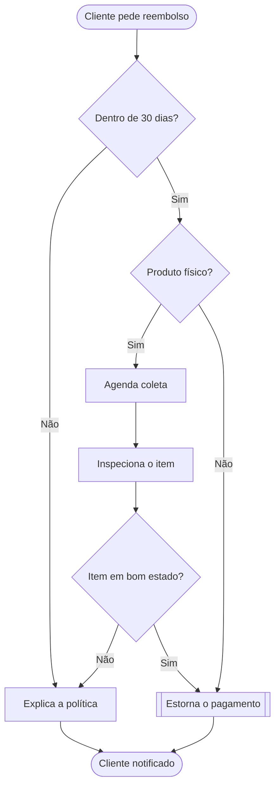

# Romeid flowcharts

You write the flowchart in Mermaid; Romeid lays it out, colors it by meaning and animates it. The whole diagram is compressed into the link's `#fragment`, so nothing is uploaded or stored and the link never expires. Never shorten, wrap or edit the URL: a changed character breaks it.

## Workflow

1. **Understand the flow.** Identify where it starts and ends, the steps, the decisions and their outcomes, loops, data stores and the systems or phases involved. If something essential is ambiguous, make a reasonable assumption and say so in one line instead of asking, unless the user clearly wants to be consulted.
2. **Write the Mermaid** following the rules below. Syntax details, shapes and fixes for common errors: [references/flowchart-syntax.md](references/flowchart-syntax.md).
3. **Get the link**, using the first option that is available:
   1. MCP tool `share_flowchart` from the `romeid` server. Pass `mermaid`, a short `title`, and appearance options only if the user asked for them.
   2. The CLI, which validates with the real Mermaid parser:
      ```bash
      npx -y @mglnb/romeid share diagram.mmd --title "Checkout"
      ```
      Write the diagram to a temporary `.mmd` file first (or pipe it through stdin). stdout is just the URL; suggestions go to stderr. If the command itself fails (no network, package unavailable), move on to the next option instead of retrying.
   3. Fallback bundled with this skill (basic checks only, no dependencies, works offline):
      ```bash
      node <skill-dir>/scripts/share.mjs diagram.mmd --title "Checkout"
      ```
   On a syntax error, fix the reported line (the message includes a hint) and try again, at most three times. Treat readability suggestions as worth applying before you reply.
4. **Reply** in the user's language:
   - The link first, on its own line: `[Open the flowchart on Romeid](<url>)`.
   - One or two sentences on what the diagram shows, plus any assumption you made.
   - The Mermaid source in a ```` ```mermaid ```` block, so it renders on GitHub or Notion and stays editable.
   - A short offer to adjust (more detail, another direction, split into parts).

## Writing flowcharts that read well

- **Direction:** `flowchart TD` for processes and decisions; `flowchart LR` for pipelines, timelines and architectures.
- **Shapes carry meaning**, and Romeid colors nodes by shape, so pick them deliberately:
  | Meaning | Syntax |
  |---|---|
  | Start / end | `start([Customer opens cart])` |
  | Step / action | `review[Review items]` |
  | Decision | `paid{Payment approved?}` |
  | Data store | `db[(Orders)]` |
  | Input / output | `upload[/Upload receipt/]` |
  | Sub-process | `notify[[Send confirmation]]` |
  | Signal / event | `alert>Slack alert]` or `evt((Webhook))` |
- **Labels:** 2 to 6 words. Steps start with a verb ("Validate card"), decisions are questions ("Stock available?"). Quote any label containing punctuation or brackets: `a["Pay (card)"]`.
- **Every decision exit gets a label:** `paid -->|Yes| ship` and `paid -->|No| retry`, in the user's language.
- **Ids** are short ASCII words (`checkout`, `payOk`). Never use `end` as an id.
- **Group** phases, teams or systems with `subgraph id [Title] ... end`.
- **Edge styles:** `-->` normal, `==>` the main or happy path, `-.->` optional or asynchronous, `--o` / `--x` for “uses” / “blocks” when that helps.
- **Size:** aim for under ~30 nodes. For bigger processes, make an overview plus one diagram per phase, each with its own link.
- **Colors:** don't add `classDef`/`style` unless a color carries meaning the shapes don't already convey.

## Appearance options

Only when the user asks for a look. MCP arguments / CLI flags:

| Option | Values | CLI |
|---|---|---|
| `palette` | `aurora` (default), `brasa` (warm), `oceano` (cool), `grafite` (near-monochrome, good for print) | `--palette` |
| `nodeStyle` | `soft` (default), `vivid` | `--style` |
| `colorMode` | `semantic` by shape (default), `depth` by step, `group` by subgraph | `--colors` |
| `edgeStyle` | `orthogonal` (default), `curved`, `straight` | `--edges` |
| `perspective` | `true` opens the 3D view | `--3d` |
| `direction` | `TB`, `LR`, `BT`, `RL` (overrides the header) | `--direction` |

Links point to `https://romeid.mnbdev.space/app` unless the `ROMEID_URL` environment variable (or `--base`) names another deployment.

## Example

User: "faz um fluxograma do nosso processo de reembolso"



Then call `share_flowchart` with `title: "Reembolso"` and reply with the link, a sentence about the flow, the Mermaid block and an offer to adjust.
