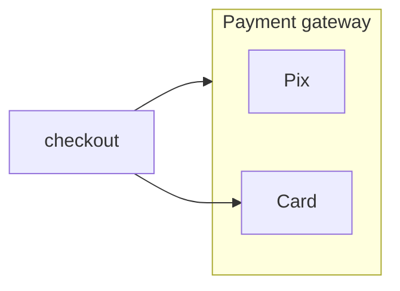
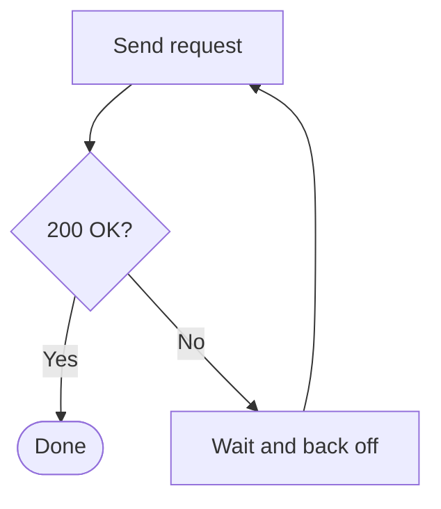
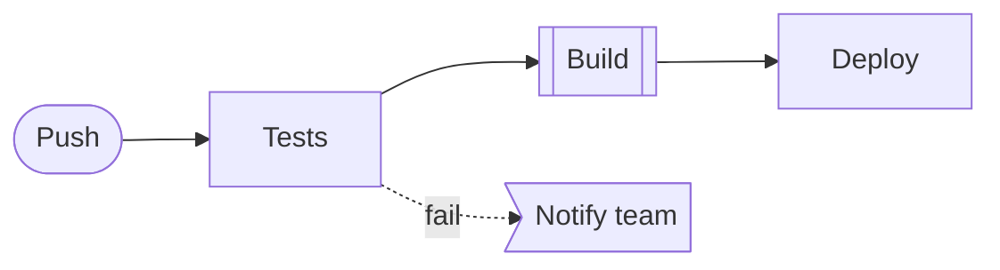

# Mermaid flowchart syntax (what Romeid renders)

Romeid renders `flowchart` / `graph` diagrams only. Other Mermaid types (sequence, class, state, gantt…) are rejected; rewrite them as a flowchart.

## Header

```mermaid
flowchart TD   %% TD/TB top→bottom, BT bottom→top, LR left→right, RL right→left
```

## Nodes

| Shape | Syntax | Use for |
|---|---|---|
| Rectangle | `id[Text]` | a step or action |
| Rounded | `id(Text)` | a softer step |
| Stadium | `id([Text])` | start and end |
| Sub-process | `id[[Text]]` | a reusable procedure |
| Cylinder | `id[(Text)]` | database, storage, queue |
| Circle | `id((Text))` | event, connector |
| Double circle | `id(((Text)))` | final state |
| Decision | `id{Text?}` | a question with several exits |
| Hexagon | `id{{Text}}` | preparation, condition |
| Parallelogram | `id[/Text/]` / `id[\Text\]` | input / output |
| Trapezoid | `id[/Text\]` / `id[\Text/]` | manual operation |
| Flag | `id>Text]` | signal, notification |
| Document | `id@{ shape: doc, label: "Text" }` | a document or report |

A node is declared the first time it appears; later references use only the id.

For a node representing a named service or technology, place a verified icon token at the start of a quoted label: `db["{aws:amazon-rds} Amazon RDS"]` or `api["{dev:nodejs} Node.js API"]`. The token stays in the Mermaid source, and Romeid renders the icon. See [icons.md](icons.md) for IDs and selection rules.

## Edges

| Syntax | Meaning |
|---|---|
| `a --> b` | arrow |
| `a --- b` | line without arrow |
| `a -.-> b` | dotted (optional, async) |
| `a ==> b` | thick (main path) |
| `a --o b` / `a --x b` | circle / cross end |
| `a <--> b` | both directions |
| `a -->|Yes| b` or `a -- Yes --> b` | labeled edge |
| `a --> b & c` | fan out to several nodes |
| `a --> b --> c` | chain |

## Subgraphs



Edges may target a node inside a subgraph or the subgraph id itself. Subgraphs can nest.

## Text

- Wrap labels that contain `( ) [ ] { } | < > : ;` or a leading `-` in double quotes: `a["Pay (card)"]`.
- Literal quote: `#quot;`. Line break inside a label: `<br>`.
- Bold/italic: `a["**Bold** and *italic*"]`.
- Comments: lines starting with `%%`.

## Common errors and fixes

| Error | Cause | Fix |
|---|---|---|
| unexpected `PS` / `PE` | parentheses in an unquoted label | `a["Text (detail)"]` |
| unexpected `SQS` / `SQE` | brackets in an unquoted label | `a["List [3]"]` |
| unexpected `end` | a node named `end` | rename it (`finish`, `done`) |
| unexpected `EOF` | an edge without target or a subgraph without `end` | complete the statement |
| unexpected `PIPE` | a `\|` inside an edge label | rephrase or use `#124;` |
| "No diagram type detected" | missing header | start with `flowchart TD` |

## Patterns

Retry loop:



Pipeline with a failure branch:


