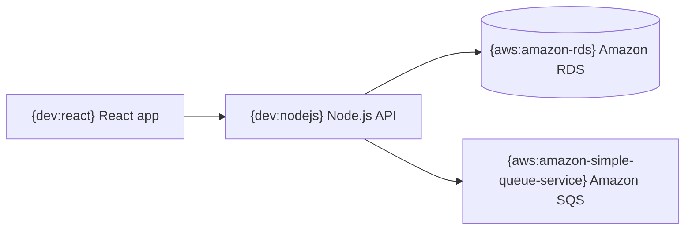

# Icon tokens in Romeid Mermaid

Place one token at the **start of a quoted node label**, followed by a space and readable text:

Choose icons by the **specific service or technology represented by the node**, not by a loosely related word. Do not put icons on decisions, generic actions, or nodes whose technology is unknown. The text remains readable in Mermaid viewers that do not render Romeid icons. Use only IDs from the catalog; an unknown token appears as text.

## Verified AWS IDs

| Service | Token |
|---|---|
| Amazon S3 | `{aws:amazon-simple-storage-service}` |
| Amazon EC2 | `{aws:amazon-ec2}` |
| Amazon RDS | `{aws:amazon-rds}` |
| AWS Lambda | `{aws:aws-lambda}` |
| Amazon CloudFront | `{aws:amazon-cloudfront}` |
| Amazon Route 53 | `{aws:amazon-route-53}` |
| Amazon DynamoDB | `{aws:amazon-dynamodb}` |
| Amazon API Gateway | `{aws:amazon-api-gateway}` |
| Amazon ECS | `{aws:amazon-elastic-container-service}` |
| Amazon EKS | `{aws:amazon-elastic-kubernetes-service}` |
| Amazon SQS | `{aws:amazon-simple-queue-service}` |
| Amazon SNS | `{aws:amazon-simple-notification-service}` |
| Amazon VPC | `{aws:amazon-virtual-private-cloud}` |

AWS also accepts common aliases such as `{aws:s3}`, `{aws:ec2}` and `{aws:lambda}`. Prefer full IDs in generated diagrams.

## Verified development IDs

| Technology | Token |
|---|---|
| Docker | `{dev:docker}` |
| Kubernetes | `{dev:kubernetes}` |
| Terraform | `{dev:terraform}` |
| Ansible | `{dev:ansible}` |
| GitHub Actions | `{dev:githubactions}` |
| GitLab | `{dev:gitlab}` |
| Jenkins | `{dev:jenkins}` |
| React | `{dev:react}` |
| Next.js | `{dev:nextjs}` |
| Angular | `{dev:angular}` |
| Vue.js | `{dev:vuejs}` |
| Node.js | `{dev:nodejs}` |
| Python | `{dev:python}` |
| TypeScript | `{dev:typescript}` |
| PostgreSQL | `{dev:postgresql}` |
| Redis | `{dev:redis}` |
| NGINX | `{dev:nginx}` |
| Prometheus | `{dev:prometheus}` |
| Grafana | `{dev:grafana}` |

For any other technology, look the ID up in the full catalog at https://romeid.mnbdev.space/icons.json (`aws.icons`, `aws.aliases`, `dev`, `lucide`) instead of guessing. A quick check also works: `https://romeid.mnbdev.space/<library>-icons/<id>.svg` returns 200 for a valid ID and 404 otherwise.
